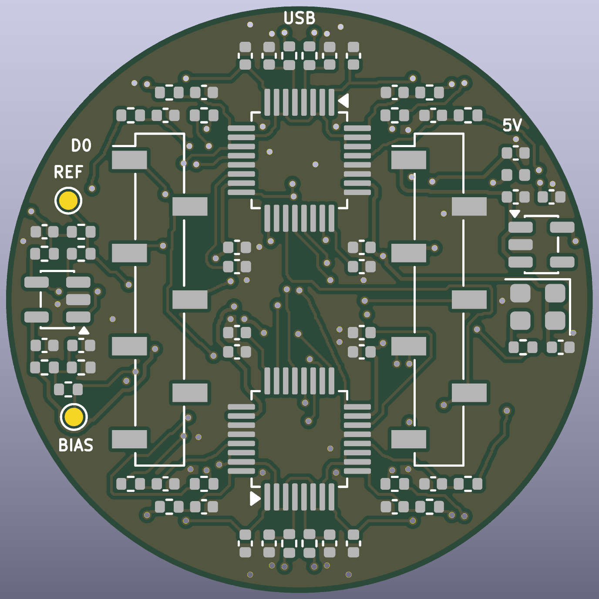

# Limpet-16

An open-source, 16-channel dry-electrode EEG front end on one 40 mm board.
Eighteen spring-loaded pins press on one spot of the scalp, two 24-bit
converters digitise them, and an on-board ESP32-C3 radio module streams the
samples over Bluetooth LE. Power and programming go through one USB-C socket.



> **Not a medical device.** This is an experimenter's board. It has no
> isolation from its power supply: wear it only while it runs from a battery or
> power bank, never while it is connected to a computer or a wall charger.

> **Status: revision B, not yet built.** The design passes KiCad's electrical
> and design-rule checks and the firmware compiles and passes its PC-side
> tests, but no board has been manufactured or powered. Expect to debug. There
> are no measured noise or performance figures yet. See
> [what has and has not been verified](#what-has-been-verified).

## What it is

| | |
|---|---|
| Channels | 16, plus a reference pin and a bias pin, in one 30 mm cluster |
| Electrodes | 18 surface-mount spring pins, 4 mm tip, 6.5 mm apart |
| Converters | 2 x TI ADS131M08, 24-bit, all channels sampled at the same instant |
| Sample rate | 250 samples/s nominal (8.192 MHz clock, highest oversampling setting; not yet measured) |
| Reference | Buffered by a low-noise op-amp (can be bypassed) |
| Processor and radio | Espressif ESP32-C3-WROOM-02 module, soldered on |
| Link | Bluetooth LE, one 51-byte packet per sample |
| Board | 40 mm round, 4 layers, 1.0 mm thick; parts on top, pins underneath |
| Power and flashing | USB-C on the board, 5 V from a power bank |

Limpet-16 is an independent design inspired by the PiEEG "Octopus 16" idea of
putting the whole montage, reference included, on one small board. It shares no
design files or code with that product (which publishes neither schematics nor
a licence); it is drawn from the component datasheets. Its data stream uses the
same packet layout, so viewers written for that format can read it.
[How it differs](docs/DESIGN.md#how-it-differs-from-the-board-that-inspired-it).

Revision A (32 mm, with a plug-in Seeed XIAO ESP32-S3 instead of an on-board
module) is kept under the git tag `rev-A`.

## Repository map

```
README.md            you are here
LICENSE              which licence covers what
docs/
  BUILD.md           order, assemble, flash, first signal: start here to make one
  DESIGN.md          how the circuit works, pin maps, limits, open questions
  img/               renders and layer pictures
hardware/
  limpet16.kicad_pro / .kicad_sch / .kicad_pcb    open these in KiCad 9
  lib/               the two project footprints (spring pin, radio module)
  production/        ready-to-upload gerbers, BOM, placement files, schematic PDF
  scripts/           the design as code: one file in, schematic + board out
firmware/
  limpet16/          PlatformIO project for the on-board ESP32-C3
  test/              PC-side tests of the driver against a simulated converter
software/
  limpet16.py        record to CSV over Bluetooth
```

## Make one

The short version; [docs/BUILD.md](docs/BUILD.md) has every step.

1. Upload `hardware/production/limpet16-gerbers.zip` to a board house
   (4 layers, 1.0 mm, ENIG finish).
2. Have the top side assembled from `bom-jlcpcb.csv` and
   `positions-top-jlcpcb.csv`, or solder it yourself.
3. Solder the 18 spring pins by hand.
4. Plug in USB-C and flash: `cd firmware/limpet16 && pio run -t upload`.
5. Power it from a power bank and run
   `python3 software/limpet16.py --seconds 30`.

## Change it

The whole board is generated from one Python file,
[`hardware/scripts/design.py`](hardware/scripts/design.py): every part, net and
position. Edit it and run

```
hardware/scripts/build.sh
```

to regenerate the schematic, place and route the board, run the checks and
write new fabrication files (needs KiCad 9 and numpy; routing takes 6 to 12
minutes). The router is a simple one written for this board and it does not
succeed every time: of three full rebuilds of this exact design, one connected
everything, and that is the board committed here. When it fails it says so and
puts the previous board back; run it again or nudge a part. You can also just
open the KiCad files and edit them by hand, but
then stop using the generator, because it overwrites them.

## What has been verified

| Check | Result |
|---|---|
| Schematic electrical rules (KiCad ERC, all severities) | 0 violations |
| Board design rules (KiCad DRC, all severities) | 0 violations, 0 unconnected |
| Schematic and board agree (DRC parity, plus a pin-by-pin netlist comparison with `design.py`) | 0 differences |
| Rebuilding the board from `design.py` gives a complete board every time | **no**: 1 of 3 attempts; the committed board is the complete one |
| Firmware driver and packet code against a simulated ADS131M08 (`firmware/test/run.sh`) | pass |
| Firmware builds for the ESP32-C3 (PlatformIO, Arduino core, NimBLE-Arduino) | builds, 753 kB flash |
| Recorder packet decoder (`limpet16.py --selftest`) | pass |
| A manufactured board | **not done** |
| Firmware on real hardware, Bluetooth range and throughput, noise, signal quality | **not done** |

## Licence

Hardware: CERN-OHL-P-2.0. Firmware and software: MIT. Documentation: CC-BY-4.0.
See [LICENSE](LICENSE). You may build, change and sell it.
