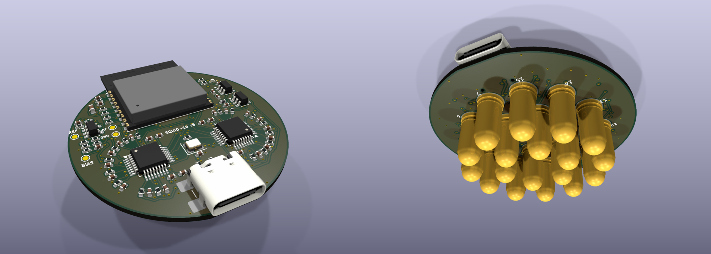

<div align="center">

# Squid-16

**An open-source, 16-channel dry-electrode EEG sensor on one 40 mm board.**

Eighteen spring-loaded pins, two 24-bit converters, an on-board ESP32-C3 and Bluetooth LE.
No gel, no cap, no separate controller.



<sub>3D render from the design files, not a photograph. No board has been built yet.</sub>

[](LICENSES/CERN-OHL-P-2.0.txt)
[](LICENSES/MIT.txt)
[](#what-has-been-verified)
[](hardware)

[Build one](docs/BUILD.md) · [How it works](docs/DESIGN.md) · [Simulation results](sim/results/report.md) · [Get one](#get-one) · [Cost](#what-it-costs)

</div>

> **Not a medical device.** This is an experimenter's board. It has no
> isolation from its power supply: wear it only while it runs from a battery or
> power bank, never while it is connected to a computer or a wall charger.

> **Status: revision B, not yet built.** The design passes KiCad's electrical
> and design-rule checks, the firmware compiles and passes its PC-side tests,
> and the wiring has been checked in simulation, but no board has been
> manufactured or powered. Expect to debug. There are no measured noise or
> performance figures yet. See
> [what has and has not been verified](#what-has-been-verified).

## What it is

| | |
|---|---|
| Channels | 16, plus a reference pin and a bias pin, in one 30 mm cluster |
| Electrodes | 18 surface-mount spring pins, 4 mm tip, 6.5 mm apart |
| Converters | 2 x TI ADS131M08, 24-bit, all channels sampled at the same instant |
| Sample rate | 250 samples/s nominal (8.192 MHz clock, highest oversampling setting; not yet measured) |
| Reference | Buffered by a low-noise op-amp (can be bypassed) |
| Processor and radio | Espressif ESP32-C3-WROOM-02 module, soldered on |
| Link | Bluetooth LE, one 51-byte packet per sample |
| Board | 40 mm round, 4 layers, 1.0 mm thick; parts on top, pins underneath |
| Power and flashing | USB-C on the board, 5 V from a power bank |

Squid-16 is an independent design inspired by the PiEEG "Octopus 16" idea of
putting the whole montage, reference included, on one small board. It shares no
design files or code with that product (which publishes neither schematics nor
a licence); it is drawn from the component datasheets. Its data stream uses the
same packet layout, so viewers written for that format can read it.
[How it differs](docs/DESIGN.md#how-it-differs-from-the-board-that-inspired-it).

This project is not affiliated with, endorsed by or supported by PiEEG.
"PiEEG" and "Octopus 16" are names used by their owner and appear here only
to say what inspired this design.

Revision A (32 mm, with a plug-in Seeed XIAO ESP32-S3 instead of an on-board
module) is kept under the git tag `rev-A`.

## Repository map

```
README.md            you are here
LICENSE              which licence covers what
docs/
  BUILD.md           order, assemble, flash, first signal: start here to make one
  DESIGN.md          how the circuit works, pin maps, limits, open questions
  img/               renders and layer pictures
hardware/
  squid16.kicad_pro / .kicad_sch / .kicad_pcb    open these in KiCad 9
  lib/               the two project footprints (spring pin, radio module) and a 3D model of the pin
  production/        ready-to-upload gerbers, BOM, placement files, schematic PDF
  scripts/           the design as code: one file in, schematic + board out
firmware/
  squid16/          PlatformIO project for the on-board ESP32-C3
  test/              PC-side tests of the driver against a simulated converter
software/
  squid16.py        record to CSV over Bluetooth
sim/
  run_all.py         simulate this board; results in sim/results/report.md
```

## Get one

**Nobody sells built Squid-16 boards.** This is a design you have made for
you. There are three ways to end up holding one:

| Route | What you do | Skill needed |
|---|---|---|
| **Have it built** (easiest) | Upload [`hardware/production/squid16-pcbway.zip`](hardware/production/squid16-pcbway.zip) to a turnkey assembler such as PCBWay. It contains the gerbers, a parts list with manufacturer part numbers, placement files and a notes file. They make the board, buy the parts and solder them. You flash the firmware over USB-C. | None beyond placing an order |
| **Have the top side built, fit the pins yourself** | Same package, ask for top side only. Solder the 18 spring pins with an ordinary iron (one large pad each). | Basic soldering |
| **Build it all yourself** | Order bare boards from the gerbers and follow [docs/BUILD.md](docs/BUILD.md). | Fine-pitch surface-mount soldering, hot air |

After that: plug in USB-C, run `pio run -t upload` in `firmware/squid16`,
power it from a power bank and run `python3 software/squid16.py`.
[docs/BUILD.md](docs/BUILD.md) has every step.

If you would rather buy a finished unit, open an issue saying so. There is no
promise that a batch will be made, but it is the only way interest gets
counted.

Because this revision is untested, order the minimum (five boards, two
assembled) and expect the first one to need debugging.

## What it costs

Figures for **five bare boards with two assembled**, the smallest sensible
order. The PCBWay figures are what its online calculator showed for this
design's gerbers on 10 November 2026, before their engineers' review; the rest
are estimates. Import VAT and duty are extra.

| Item | Cost (USD) | Source |
|---|---|---|
| 5 bare boards: 4 layers, 1.0 mm, ENIG, 5-day build | 62 | PCBWay calculator |
| Assembly labour, 2 boards, one or both sides | 88 | PCBWay calculator |
| Courier shipping | about 29, offset by a first-order discount at the time | PCBWay calculator |
| Components for 2 boards, excluding the spring pins | 80 - 110 | estimate from distributor prices |
| 36 Mill-Max spring pins (18 per board) | about 145 | DigiKey list price, about 4 each |
| **Two working boards, Mill-Max pins** | **about 375 - 405** | |
| **Per board** | **about 190 - 200** | |

Ways to spend less:

- Generic 4 x 11 mm surface-mount pogo pins fit the same pads and cost a
  small fraction of the Mill-Max part. Untested, like everything else here.
- Lead-free HASL instead of ENIG roughly halves the bare-board price (32
  instead of 62), at the cost of less flat pads.
- The three spare bare boards cost only parts to populate later.

## Change it

The whole board is generated from one Python file,
[`hardware/scripts/design.py`](hardware/scripts/design.py): every part, net and
position. Edit it and run

```
hardware/scripts/build.sh
```

to regenerate the schematic, place and route the board, run the checks and
write new fabrication files (needs KiCad 9 and numpy; routing takes 6 to 12
minutes). The router is a simple one written for this board and it does not
succeed every time: of three full rebuilds of this exact design, one connected
everything, and that is the board committed here. When it fails it says so and
puts the previous board back; run it again or nudge a part. You can also just
open the KiCad files and edit them by hand, but
then stop using the generator, because it overwrites them.

## What has been verified

| Check | Result |
|---|---|
| Schematic electrical rules (KiCad ERC, all severities) | 0 violations |
| Board design rules (KiCad DRC, all severities) | 0 violations, 0 unconnected |
| Schematic and board agree (DRC parity, plus a pin-by-pin netlist comparison with `design.py`) | 0 differences |
| Rebuilding the board from `design.py` gives a complete board every time | **no**: 1 of 3 attempts; the committed board is the complete one |
| Firmware driver and packet code against a simulated ADS131M08 (`firmware/test/run.sh`) | pass |
| Firmware builds for the ESP32-C3 (PlatformIO, Arduino core, NimBLE-Arduino) | builds, 753 kB flash |
| Recorder packet decoder (`squid16.py --selftest`) | pass |
| Wiring traced from the PCB copper against the firmware's pins and channel order ([simulation](sim/results/report.md)) | 16 of 16 channels in the right place |
| A manufactured board | **not done** |
| Firmware on real hardware, Bluetooth range and throughput, noise, signal quality | **not done** |

## Licence

Hardware: CERN-OHL-P-2.0. Firmware and software: MIT. Documentation: CC-BY-4.0.
See [LICENSE](LICENSE). You may build, change and sell it.
