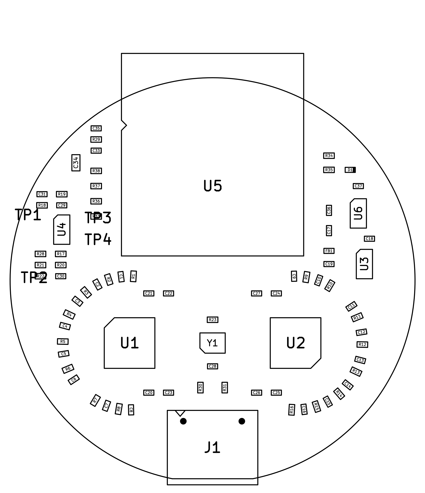

# Building a Limpet-16

Read the safety note first, then work down the page.

## Safety

- This is not a medical device and has no certification of any kind.
- The board is not isolated. While it touches a person it must run from a
  battery or power bank only. Connect it to a computer only for flashing, with
  the board off the head.
- You build and use it at your own risk.

## 1. What to buy

Full list with part numbers: [`hardware/production/bom.csv`](../hardware/production/bom.csv).

| Item | Qty | Notes |
|---|---|---|
| Bare or assembled board | 1 (boards come in fives) | see step 2 |
| Mill-Max 0845-0-15-20-52-14-11-0 spring pin | 18 | or generic 4 x 11 mm surface-mount pogo pins |
| Small 5 V power bank and a short USB-C cable | 1 | a data cable, for flashing |
| Elastic headband or strap | 1 | to hold the board on the head |

If you assemble the top side yourself you also need everything in the BOM
marked "top": the ESP32-C3-WROOM-02 module, the USB-C socket (GCT USB4110),
two ADS131M08IPBSR, the AP2112K and LP5907 regulators, OPA376AIDBVR, the
SiT1602 8.192 MHz oscillator, an LED, a ferrite bead and 0402 resistors and
capacitors. The module's edge pads can be done with an iron. The 0402 parts,
the 0.5 mm pitch converters and above all the USB-C socket (0.5 mm pitch
contacts tucked under its shell) need hot air or a hot plate, flux and
magnification. Having the top side assembled by the board house is the easier
route.

## 2. Order the board

Upload [`hardware/production/limpet16-gerbers.zip`](../hardware/production/limpet16-gerbers.zip)
to a board house and choose:

| Setting | Value |
|---|---|
| Layers | 4 |
| Size | 40 x 40 mm (round, one short straight edge) |
| Thickness | 1.0 mm (1.6 mm also works, a little heavier) |
| Surface finish | ENIG (flat pads for the fine-pitch chips and the spring pins) |
| Minimum track / spacing | 0.127 mm (5 mil) |
| Minimum hole | 0.3 mm |
| Layer order | F_Cu, In1_Cu, In2_Cu, B_Cu |

To have the top side assembled as well, also upload
[`bom-jlcpcb.csv`](../hardware/production/bom-jlcpcb.csv) and
[`positions-top-jlcpcb.csv`](../hardware/production/positions-top-jlcpcb.csv)
(JLCPCB's column layout; `positions-top.csv` is the same data as KiCad writes it).
The supplier part-number column in the BOM is empty: match each line to the
assembler's catalogue by the manufacturer part number or the value. **Check
the part rotation preview before you pay**, especially the radio module
(antenna pointing off the board, away from the USB socket), the two ADS131M08
(pin 1 marks are on the silkscreen), the oscillator, the LED and the three
SOT-23-5 parts; placement files often need a rotation correction at the
assembler. R19 is deliberately left empty. Tell the assembler that the module
overhangs the board edge on purpose.

The spring pins are not in the assembly files; you solder those.

## 3. Solder the rest

The board has no part numbers printed on it (there is no room). Use the
assembly drawing to find R18, U3 and the rest:
[picture](img/assembly-top.png), [PDF](../hardware/production/limpet16-assembly-top.pdf).



If you are soldering the top side yourself, do it before the pins, smallest
parts first, the module last. The module goes with its antenna end over the
board edge opposite the USB socket; its pin 1 corner is marked on the
silkscreen.

Then the pin side.

1. **Spring pins.** With solder paste and hot air (or a hot plate): put paste
   on each 5 mm pad, stand a pin on each, and reflow. The pins self-centre on
   round pads. With an iron: tin the pad, hold the pin with tweezers by its
   barrel and reflow the pad from the side. Do not press on the plunger while
   the solder is molten, and keep flux out of the barrel. Go gently with hot
   air: the parts on the other side are already soldered.
2. Check all 18 pins stand straight and move freely.

## 4. Check before power

With a multimeter, nothing plugged in:

| Between | Expect |
|---|---|
| USB socket shell (ground) and C36 pad on the +5V side | not shorted |
| `GND` pad and the +3V3 side of C37 | not shorted |
| Any two neighbouring spring pins | not shorted |
| BIAS pin and the `GND` pad | roughly 9 to 12 kOhm once the meter has charged C30 (2.2 kOhm plus the bias divider) |

Then power it from USB and measure against the `GND` pad:

| Point | Expect |
|---|---|
| C37 (+3V3) | 3.3 V |
| U3 pin 5 / C18 (AVDD) | 3.3 V |
| C19 (DVDD) | 3.3 V |
| BIAS spring pin | 1.1 V |
| REF spring pin, not touching anything | 1.1 V |

## 5. Flash the firmware

Board off the head, USB-C data cable to a computer.

```
pip install platformio
cd firmware/limpet16
pio run -t upload
pio device monitor
```

The module's built-in USB port does the flashing; a new module normally shows
up as a serial port by itself. If no port appears, or the upload cannot
connect, unplug USB, bridge the `BOOT` pad to the `GND` pad beside it with
tweezers, plug USB in while they are bridged, then let go and upload again.
After flashing this way, unplug and replug to start the firmware. The monitor
should print both converter IDs (`0x28xx`) and `converters configured`.

To run the PC-side firmware tests (no hardware needed): `firmware/test/run.sh`.

## 6. Power

Power the board from a power bank through its USB-C socket. Some power banks
switch off when the load is as small as this board; if yours does, use one
with a low-current mode.

| LED on the board | Meaning |
|---|---|
| Slow blink | waiting for a Bluetooth connection |
| On | connected and streaming |
| Fast double blink | converters not found: clock or soldering fault |

## 7. First signals

```
pip install bleak
python3 software/limpet16.py --seconds 30 --out test.csv
```

1. **On the bench:** short all pins together with foil. Every channel should be
   a flat line of a few microvolts or less.
2. **On the forehead:** hold the board against skin, press straight down, keep
   still. Blinks should appear as large slow deflections.
3. **On the back of the head**, hair parted: close your eyes for ten seconds
   and look for 8-12 Hz activity that fades when you open them.

Contact quality on all 18 pins, the reference and bias pins above all, decides
what you see. Clean the tips with isopropyl alcohol; never use oil.

## 8. If it does not work

| Symptom | Look at |
|---|---|
| Fast double blink | 3.3 V on DVDD and AVDD; 8.192 MHz at R23; solder bridges on U1/U2 or the module's pads |
| One converter ID reads `0x0000` or `0xFFFF` | that chip's CS line (GPIO7 for ADC A, GPIO6 for ADC B) and its solder joints |
| All channels saturated | bias pin not touching; BIAS not at 1.1 V |
| All channels show the same large mains hum | reference pin not touching |
| No serial port and no LED | 5 V at C36; the two 5.1 kOhm resistors by the USB socket (R30, R31); try a USB-A to C cable |
| Bluetooth name never appears | module soldering, 3.3 V at C37, antenna end not covered by anything metal |
| One channel flat or noisy | that pin's solder joint and its 4.7 kOhm resistor |
| Lost packets reported by the recorder | move closer; close other Bluetooth apps |

Please write down what you find: this revision has not been built before, and
[the open questions](DESIGN.md#known-limits-and-open-questions) are waiting for
measurements.

## Regenerating the design files

Needs KiCad 9 (`kicad-cli` and its Python module `pcbnew`) and numpy.

| Command (from `hardware/`) | Does |
|---|---|
| `scripts/build.sh` | everything below, in order |
| `python3 scripts/gen_sch.py` | writes the schematic from `scripts/design.py` |
| `python3 scripts/gen_pcb.py` | writes the placed, unrouted board |
| `python3 scripts/route.py` | routes it and pours the ground fills |
| `scripts/check.sh` | ERC and DRC with schematic parity, reports in `production/reports/` |
| `scripts/export.sh` | gerbers, drill, BOM, placement, PDFs, pictures |
