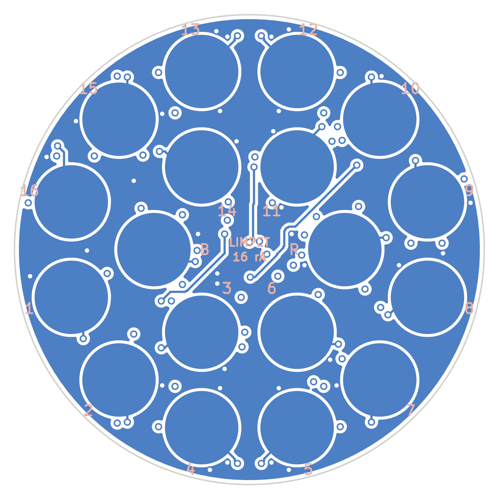
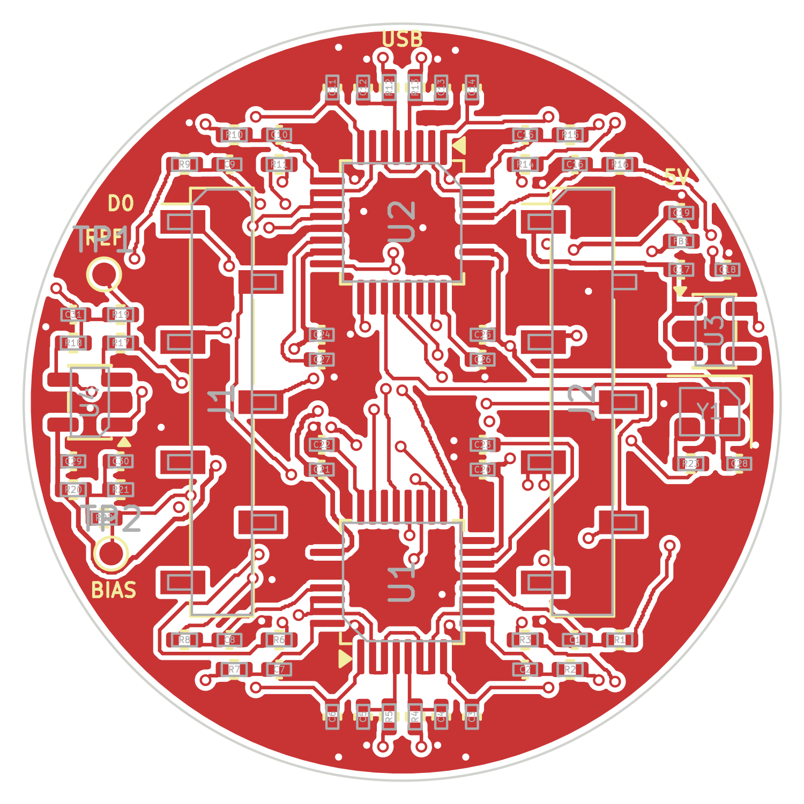

# How Limpet-16 works

Schematic: [PDF](../hardware/production/limpet16-schematic.pdf),
[SVG](img/schematic.svg), or open `hardware/limpet16.kicad_sch` in KiCad.

## Signal path

```
16 signal pins --4k7--+-- AINxP \
                   220 pF        >  2 x ADS131M08 --SPI--> XIAO ESP32-S3 --BLE-->
                      |         /        ^
                     GND   AINxN         | 8.192 MHz oscillator
                             |
 reference pin --10k--> op-amp buffer --100R--+ (all 16 negative inputs, "REFN")

 bias pin <--2k2-- 1.1 V (20k / 10k divider from the 3.3 V analog rail, 1 uF)
```

- Every channel measures its pin against the same reference node, so all 16
  channels are "referential" to the reference pin in the middle of the cluster.
- The bias pin holds the body at 1.1 V relative to board ground. That keeps the
  inputs inside the range of both the converters and the single-supply buffer.
- Each input has a 4.7 kOhm series resistor and 220 pF to ground. The resistor
  limits current into the converter input; the capacitor keeps radio-frequency
  pickup and the converter's sampling glitches off the electrode. The capacitor
  is deliberately small: a dry pin can have a source impedance of 100 kOhm to
  1 MOhm, and with 220 pF the low-pass corner that forms is 7 kHz to 700 Hz,
  clear of the EEG band. (TI's usual 10 nF would put it at 160 Hz to 16 Hz.)
- The converters use their internal 1.2 V reference. At the default gain of 4
  the range is +-300 mV and one count is 0.0358 uV.
- Converter-internal high-pass (about 0.6 Hz) removes electrode offset; the
  firmware turns it on.

## Power

| Rail | Source | Feeds |
|---|---|---|
| +5V | XIAO 5V pin (USB) | LP5907 regulator |
| AVDD 3.3 V | LP5907, low noise | converter analog supply, op-amp, bias divider |
| DVDD 3.3 V | XIAO 3V3 pin through a ferrite bead | converter digital supply, oscillator |

Analog and digital ground are one net with a solid plane on layer 2.

## XIAO pin map

Looking at the top of the board with the `USB` mark away from you:

| Left socket J1 | Signal | Right socket J2 | Signal |
|---|---|---|---|
| D0 | CS, ADC A (channels 1-8) | 5V | +5V in |
| D1 | DRDY from ADC A | GND | ground |
| D2 | SYNC/RESET, both ADCs | 3V3 | digital 3.3 V in |
| D3 | CS, ADC B (channels 9-16) | D10 | MOSI |
| D4 | not connected | D9 | MISO |
| D5 | not connected | D8 | SCLK |
| D6 | not connected | D7 | not connected |

D4 to D7 are left free on purpose. If the XIAO is plugged in turned by 180
degrees, its 5V, GND and 3V3 pins land on D6, D5 and D4, which connect to
nothing, so the board gets no supply and no ground. That is the intent; it has
not been tried, and the XIAO's signal pins would still be touching unpowered
converter pins, so unplug it promptly. The firmware reports that it cannot
find the converters (fast double blink).

## Electrode map

Millimetres from the board centre, **looking at the top (XIAO) side**, x to the
right, y towards the `USB` mark. Looking at the pin side, left and right swap;
the numbers printed beside the pins are correct for that view.

| Pin | x | y | | Pin | x | y |
|---|---|---|---|---|---|---|
| CH1 | +12.13 | -3.25 | | CH9 | -12.13 | +3.25 |
| CH2 | +8.88 | -8.88 | | CH10 | -8.88 | +8.88 |
| CH3 | +3.25 | -5.63 | | CH11 | -3.25 | +5.63 |
| CH4 | +3.25 | -12.13 | | CH12 | -3.25 | +12.13 |
| CH5 | -3.25 | -12.13 | | CH13 | +3.25 | +12.13 |
| CH6 | -3.25 | -5.63 | | CH14 | +3.25 | +5.63 |
| CH7 | -8.88 | -8.88 | | CH15 | +8.88 | +8.88 |
| CH8 | -12.13 | -3.25 | | CH16 | +12.13 | +3.25 |
| REF | -6.50 | 0 | | BIAS | +6.50 | 0 |

Six pins sit on a 6.5 mm hexagon, twelve on a 12.56 mm circle; neighbours are
6.5 mm apart. Channel n+8 is directly opposite channel n.

The converters are wired in reverse order so no tracks cross
(channel n = ADC A input 8-n for n = 1..8, ADC B input 16-n for n = 9..16). The
firmware puts them back in order; `firmware/limpet16/src/protocol.h`.



## Options you can solder

| To get | Do this |
|---|---|
| Reference straight from the electrode, no buffer | fit R19 (4.7 kOhm, 0402), remove R18, and change C31 from 10 nF to 220 pF (10 nF is right behind the buffer but far too much load for a bare electrode) |
| Bias pin at ground instead of 1.1 V | remove R20, and use the direct reference above (the buffer cannot work at 0 V) |
| An ear-clip or other remote reference / bias electrode | solder its wire to the `REF` / `BIAS` pad on the top side; leave that pin off or insulated |

With both options applied the analog front end is the plain "pin straight into
the converter" arrangement.

Do not fit R18 and R19 together: the resistor then feeds the buffer's output
back to its own input through the electrode impedance, which multiplies the
buffer's noise.

## Bluetooth protocol

| | |
|---|---|
| Name | `Limpet-16-XXXX` |
| Service | `4fafc201-1fb5-459e-8fcc-c5c9c331914b` |
| Data, notify | `beb5483e-36e1-4688-b7f5-ea07361b26a8` |
| Command, write + notify | `6c696d70-6574-4c31-9601-000000000001` |

Data packet, 51 bytes, one per sample: `0xA0`, counter (0-255, wraps),
16 x 3 bytes (channel 1 first, big-endian two's complement), `0xC0`.
Microvolts = counts x 1.2 / gain / 8388608 x 1e6.

Commands (reply arrives as a notification on the same characteristic):

| Write | Meaning | Reply |
|---|---|---|
| `'G'` code | gain code 0-7 = gain 1, 2, 4 ... 128, all channels | `'G'` code ok |
| `'R'` adc addr | read converter register (adc 0 = A, 1 = B) | `'R'` adc addr hi lo |
| `'W'` adc addr hi lo | write converter register | `'W'` adc addr ok |

The service and data UUIDs and the packet layout match the PiEEG Octopus 16
stream so that software written for it can display this board. The command
characteristic is different and uses its own UUID.

## How it differs from the board that inspired it

| | PiEEG Octopus 16 (from its public docs) | Limpet-16 |
|---|---|---|
| Design files and licence | not published | all here, CERN-OHL-P / MIT |
| Board | 26 mm round | 32 mm round |
| Pin spacing | about 5.4 mm | 6.5 mm |
| Reference | electrode into the converters | buffered by an op-amp (bypassable) |
| Body bias | ground | 1.1 V (ground selectable) |
| Analog supply | not documented | separate low-noise regulator |
| Stacking connector | yes | no |
| Nominal sample rate | quoted as 250 SPS | 251.97 SPS, the true figure for this clock and oversampling setting |

The board grew to 32 mm because the specified spring pin needs a 5 mm pad, and
the pads on the pin side leave only narrow gaps where a via can pass through
the board.

## Known limits and open questions

These matter more than anything else on this page if you are deciding whether
to build one.

1. **Nothing has been measured.** This is an untested first revision.
2. **Input impedance is low for dry electrodes.** The ADS131M08 is a metering
   converter, not a biopotential amplifier: its input impedance is 330 kOhm at
   gains 1-4 and at least 1 MOhm at gains 8-128 (datasheet figures). A dry pin
   on hair can present tens to hundreds of kOhm, so signals are attenuated and
   the attenuation differs between pins. The reference buffer removes this
   loading from the reference pin, which every channel shares; the 16 signal
   pins are still loaded. Trying gain 8 (`--gain 8`) is the first experiment
   worth doing.
3. **Reference buffer stability** into the 10 nF reservoir capacitor (C31) through 100 Ohm is
   expected to be fine for this op-amp but has not been simulated or measured.
   If it rings, raise R18 or use the direct reference.
4. **No pull-ups on CS and RESET.** They float for the fraction of a second
   before the firmware starts; the firmware drives them first thing. They were
   left out to keep the centre of the board routable.
5. **Decoupling capacitors sit 3-4 mm from the converter supply pins**, further
   than TI's layout advice, because the socket rows leave no room beside the
   chips.
6. **No ESD protection parts** beyond the series resistors.
7. **Silkscreen text is 0.55-0.7 mm high**, below the 0.8-1.0 mm many board
   houses recommend. It may print faintly.
8. **Bluetooth throughput** of 252 packets per second is a firmware assumption
   that depends on the connection interval the host grants.
9. **The Mill-Max 0845 pin has a rolling-ball tip** made for sliding contacts.
   It was chosen because it is a documented, orderable surface-mount pin of the
   right size; whether it is comfortable and makes good scalp contact is
   untested. Generic 4 x 11 mm surface-mount pogo pins fit the same pad.

10. **The socket part is not pinned down.** The footprint is KiCad's land
    pattern for the Harwin M20-786 series, whose 7-way part (M20-7860746) is
    listed as obsolete. A substitute has not been checked against the pads.
11. **A reference pin that is not touching leaves the buffer input floating**,
    so the reference node drifts to a supply rail and every channel saturates.
    There is no resistor holding it at the bias voltage; a 10 MOhm from the
    buffer input to the 1.1 V node would be a sensible addition in revision B.

## Routing

The board is placed from `design.py` and routed by
`hardware/scripts/route.py`, a small grid router written for this project
(A* search on a 0.0625 mm grid with rip-up and re-route). Tracks are 0.15 mm
(0.2 mm for supplies), clearance 0.127 mm, vias 0.5 mm with a 0.3 mm hole.
Layer 1 carries most signals, layer 2 is the ground plane, layer 3 carries the
long runs, layer 4 has the pin pads and short hops. The result is checked by
KiCad's DRC, not by the router.


