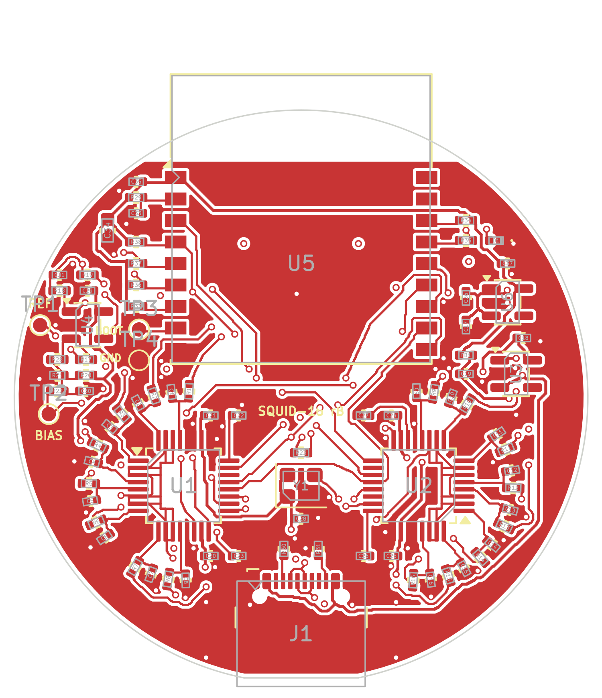

# How Squid-16 works (revision B)

Schematic: [PDF](../hardware/production/squid16-schematic.pdf),
[SVG](img/schematic.svg), or open `hardware/squid16.kicad_sch` in KiCad.

## Signal path

```
16 signal pins --4k7--+-- AINxP \
                   220 pF        >  2 x ADS131M08 --SPI--> ESP32-C3 module --BLE-->
                      |         /        ^
                     GND   AINxN         | 8.192 MHz oscillator
                             |
 reference pin --10k--> op-amp buffer --100R--+ (all 16 negative inputs, "REFN")

 bias pin <--2k2-- 1.1 V (20k / 10k divider from the 3.3 V analog rail, 1 uF)
```

- Every channel measures its pin against the same reference node, so all 16
  channels are "referential" to the reference pin in the middle of the cluster.
- The bias pin holds the body at 1.1 V relative to board ground. That keeps the
  inputs inside the range of both the converters and the single-supply buffer.
- A 10 MOhm resistor ties the buffer input to the 1.1 V node, so the reference
  does not drift to a supply rail when the reference pin is off the skin.
- Each input has a 4.7 kOhm series resistor and 220 pF to ground. The resistor
  limits current into the converter input; the capacitor keeps radio-frequency
  pickup and the converter's sampling glitches off the electrode. The capacitor
  is deliberately small: a dry pin can have a source impedance of 100 kOhm to
  1 MOhm, and with 220 pF the low-pass corner that forms is 7 kHz to 700 Hz,
  clear of the EEG band. (TI's usual 10 nF would put it at 160 Hz to 16 Hz.)
- The converters use their internal 1.2 V reference. At the default gain of 4
  the range is +-300 mV and one count is 0.0358 uV.
- Converter-internal high-pass (about 0.6 Hz) removes electrode offset; the
  firmware turns it on.

## Power

| Rail | Source | Feeds |
|---|---|---|
| +5V | USB-C socket | both regulators |
| +3V3 | AP2112K, 600 mA | radio module, pull-ups |
| DVDD 3.3 V | +3V3 through a ferrite bead | converter digital supply, oscillator |
| AVDD 3.3 V | LP5907, low noise | converter analog supply, op-amp, bias divider |

Analog and digital ground are one net with a solid plane on layer 2. The USB-C
socket has the two 5.1 kOhm resistors a USB-C supply needs to see before it
turns on 5 V. There is no fuse, no reverse-current protection and no battery
charger.

## Processor

An Espressif ESP32-C3-WROOM-02 module: a single-core RISC-V processor with
Bluetooth LE, its own crystal, 4 MB flash and a printed antenna, under a
shield, with pre-existing radio certification. It was chosen over smaller
modules because its pads are on the edges, where they can be soldered and
inspected with an iron, and because KiCad ships a maintained footprint for it.

| Module pin | Signal | Module pin | Signal |
|---|---|---|---|
| GPIO4 | DRDY from ADC A | GPIO10 | SCLK |
| GPIO5 | SYNC/RESET, both ADCs | GPIO20 | MISO |
| GPIO6 | CS, ADC B (channels 9-16) | GPIO21 | MOSI |
| GPIO7 | CS, ADC A (channels 1-8) | GPIO18 / GPIO19 | USB D- / D+ |
| GPIO8 | boot strap, pulled up | GPIO3 | status LED (on when high) |
| GPIO9 | `BOOT` pad | GPIO2 | boot strap, pulled up |
| EN | 10 kOhm pull-up, 1 uF to ground | GPIO0, GPIO1 | not connected |

Chip-select and reset lines have 10 kOhm pull-ups so the converters stay
deselected while the processor boots.

**Antenna.** The module's antenna end hangs about 2.4 mm over the board edge
(4.5 mm at its corners), opposite the USB-C socket, and no layer has copper
under the antenna. Overall the assembled board is about 42 mm long. Radio
range next to a head and a hand has not been measured.

## Electrode map

Millimetres from the board centre, **looking at the top (component) side**,
x to the right, y towards the antenna. Looking at the pin side, left and right
swap; the numbers printed beside the pins are correct for that view.

| Pin | x | y | | Pin | x | y |
|---|---|---|---|---|---|---|
| CH1 | -3.25 | +13.53 | | CH9 | +3.25 | +13.53 |
| CH2 | -3.25 | +7.03 | | CH10 | +3.25 | +7.03 |
| CH3 | -8.88 | +10.28 | | CH11 | +8.88 | +10.28 |
| CH4 | -12.13 | +4.65 | | CH12 | +12.13 | +4.65 |
| CH5 | -12.13 | -1.85 | | CH13 | +12.13 | -1.85 |
| CH6 | -8.88 | -7.48 | | CH14 | +8.88 | -7.48 |
| CH7 | -3.25 | -10.73 | | CH15 | +3.25 | -10.73 |
| CH8 | -3.25 | -4.23 | | CH16 | +3.25 | -4.23 |
| REF | -6.50 | +1.40 | | BIAS | +6.50 | +1.40 |

Six pins sit on a 6.5 mm hexagon, twelve on a 12.56 mm circle; neighbours are
6.5 mm apart. Channels 1-8 are the left half, channels 9-16 the right half,
and channel n+8 is the mirror image of channel n. The cluster is centred
1.4 mm above the board centre.

Channel n is ADC A input n-1 for n = 1..8 and ADC B input 16-n for n = 9..16
(ADC B is mounted turned round). The firmware puts them in order;
`firmware/squid16/src/protocol.h`.


## Options you can solder

| To get | Do this |
|---|---|
| Reference straight from the electrode, no buffer | fit R19 (4.7 kOhm, 0402), remove R18, and change C31 from 10 nF to 220 pF (10 nF is right behind the buffer but far too much load for a bare electrode) |
| Bias pin at ground instead of 1.1 V | remove R20, and use the direct reference above (the buffer cannot work at 0 V) |
| An ear-clip or other remote reference / bias electrode | solder its wire to the `REF` / `BIAS` pad on the top side; leave that pin off or insulated |

Do not fit R18 and R19 together: the resistor then feeds the buffer's output
back to its own input through the electrode impedance, which multiplies the
buffer's noise.

## Bluetooth protocol

| | |
|---|---|
| Name | `Squid-16-XXXX` |
| Service | `4fafc201-1fb5-459e-8fcc-c5c9c331914b` |
| Data, notify | `beb5483e-36e1-4688-b7f5-ea07361b26a8` |
| Command, write + notify | `6c696d70-6574-4c31-9601-000000000001` |

Data packet, 51 bytes, one per sample: `0xA0`, counter (0-255, wraps),
16 x 3 bytes (channel 1 first, big-endian two's complement), `0xC0`.
Microvolts = counts x 1.2 / gain / 8388608 x 1e6.

Commands (reply arrives as a notification on the same characteristic):

| Write | Meaning | Reply |
|---|---|---|
| `'G'` code | gain code 0-7 = gain 1, 2, 4 ... 128, all channels | `'G'` code ok |
| `'R'` adc addr | read converter register (adc 0 = A, 1 = B) | `'R'` adc addr hi lo |
| `'W'` adc addr hi lo | write converter register | `'W'` adc addr ok |

The service and data UUIDs and the packet layout match the PiEEG Octopus 16
stream so that software written for it can display this board. The command
characteristic is different and uses its own UUID.

## How it differs from the board that inspired it

| | PiEEG Octopus 16 (from its public docs) | Squid-16 rev B |
|---|---|---|
| Design files and licence | not published | all here, CERN-OHL-P / MIT |
| Processor | plug-in XIAO ESP32-S3 on sockets | ESP32-C3 module soldered on |
| Board | 26 mm round | 40 mm round |
| Pin spacing | about 5.4 mm | 6.5 mm |
| Reference | electrode into the converters | buffered by an op-amp (bypassable) |
| Body bias | ground | 1.1 V (ground selectable) |
| Analog supply | not documented | separate low-noise regulator |
| Stacking connector | yes | no |

## What the simulations say

[`sim/results/report.md`](../sim/results/report.md) has the numbers; none of
them is a measurement. In short:

- The wiring, firmware and recorder agree: all 16 channels come out in the
  right place at the right scale. This is the one result that does not rest
  on assumptions.
- With dry contacts of 20 kOhm to 1 MOhm, gain 4 keeps about 70 % of the
  signal and the weakest channel gets about a third of the strongest.
- Gain 8 keeps about 96 % and halves the noise, but at gain 8 and above the
  converter's inputs draw a DC current. Through a dry contact that is a DC
  error: it fills the whole input range at about 650 kOhm with the typical
  current, or about 140 kOhm on a worst-case reading of the datasheet. Gain 8
  may therefore saturate channels with poor contact. This needs measuring.
- Mains rejection as built is about 35 dB in the model. Returning the 220 pF
  input capacitors to the reference node instead of ground and raising R28
  from 10 MOhm to 100 MOhm improves that about sevenfold, but only if the
  converter's input-to-ground impedance is around 100 MOhm or more. That
  figure is not in the datasheet; at 10 MOhm the changes gain nothing, and at
  1 MOhm rejection is about 15 dB whatever is done. So this is not yet a
  reason to change the board.
- Because the reference pin sits inside the cluster, each channel sees only
  the difference in scalp potential over 6.5 to 19 mm: a few microvolts for a
  typical alpha rhythm, and almost nothing when the board sits right on the
  peak of the source.
- The reference buffer is estimated stable as built (about 70 degrees of
  phase margin); do not reduce R18 much below 100 ohm.

## Known limits and open questions

These matter more than anything else on this page if you are deciding whether
to build one.

1. **Nothing has been measured.** This is an untested revision.
2. **Input impedance is low for dry electrodes.** The ADS131M08 is a metering
   converter, not a biopotential amplifier: its input impedance is 330 kOhm at
   gains 1-4 and at least 1 MOhm at gains 8-128 (datasheet figures). A dry pin
   on hair can present tens to hundreds of kOhm, so signals are attenuated and
   the attenuation differs between pins. The reference buffer removes this
   loading from the reference pin, which every channel shares; the 16 signal
   pins are still loaded. Trying gain 8 (`--gain 8`) is the first experiment
   worth doing.
3. **The radio now shares the board with microvolt inputs.** The module sits
   directly above ten of the electrode pads with one ground plane between
   them, and its transmit bursts draw current through the same USB supply.
   Whether that shows up in the recordings is unknown until one is built.
4. **Antenna performance is untested.** The antenna overhangs the edge as
   Espressif recommends, but it is millimetres from a head.
5. **Reference buffer stability** into the 10 nF reservoir capacitor (C31)
   through 100 Ohm is expected to be fine for this op-amp but has not been
   simulated or measured. If it rings, raise R18 or use the direct reference.
6. **The 10 MOhm hold resistor loads the reference electrode slightly**
   (1 % with a 100 kOhm contact, 9 % with 1 MOhm), which reduces rejection of
   signals common to all pins. Remove R28 to get rid of it.
7. **Decoupling capacitors sit 3-4 mm from the converter supply pins**,
   further than TI's layout advice. The 5 V and 3.3 V supply tracks to the
   radio module are 0.2 mm wide and tens of millimetres long, thin for a
   module whose datasheet asks for a 0.5 A supply; the 10 uF capacitor beside
   its supply pin is what carries the transmit bursts.
8. **The module's centre ground pad has no vias under it.** They would come
   out through electrode pads. Espressif states that soldering this pad is
   optional; it is connected on the top layer only.
9. **Signal tracks run on the top layer under the radio module** (not under
   its antenna). The module is solder-masked underneath and Espressif's own
   boards do the same, but it puts SPI and supply tracks directly under the
   radio.
10. **No ESD protection, fuse or reverse-current protection** on USB.
11. **Silkscreen text is 0.5-0.7 mm high**, below the 0.8-1.0 mm many board
    houses recommend, and there are no part numbers on the board.
12. **Bluetooth throughput** of 250 packets per second is a firmware
    assumption that depends on the connection interval the host grants.
13. **The Mill-Max 0845 pin has a rolling-ball tip** made for sliding
    contacts. It was chosen because it is a documented, orderable
    surface-mount pin of the right size; whether it is comfortable and makes
    good scalp contact is untested. Generic 4 x 11 mm surface-mount pogo pins
    fit the same pad.
14. **The board is 1.0 mm thick to save weight.** Pressing 18 sprung pins
    against it flexes it slightly; whether that ever cracks a ceramic
    capacitor is untested. Order 1.6 mm if you prefer stiffness (the design
    files do not change).

15. **The exact sample rate needs measuring.** The converter datasheet's
    tables give 250 SPS for this setting, but its register description
    implies 251.97 SPS. 250 is assumed. Compare the packet count against a
    stopwatch on the first board before trusting timing-sensitive analysis.

## Routing

The board is placed from `design.py` and routed by
`hardware/scripts/route.py`, a small grid router written for this project
(A* search on a 0.0625 mm grid with rip-up and re-route). Tracks are 0.15 mm
(0.2 mm for supplies), clearance 0.127 mm, vias 0.5 mm with a 0.3 mm hole.
Layer 1 carries most signals, layer 2 is the ground plane, layer 3 carries the
long runs, layer 4 has the pin pads and short hops. The sixteen negative
inputs are joined by a hand-placed spine under each converter so the positive
inputs can fan out freely. The result is checked by KiCad's DRC, not by the
router.


