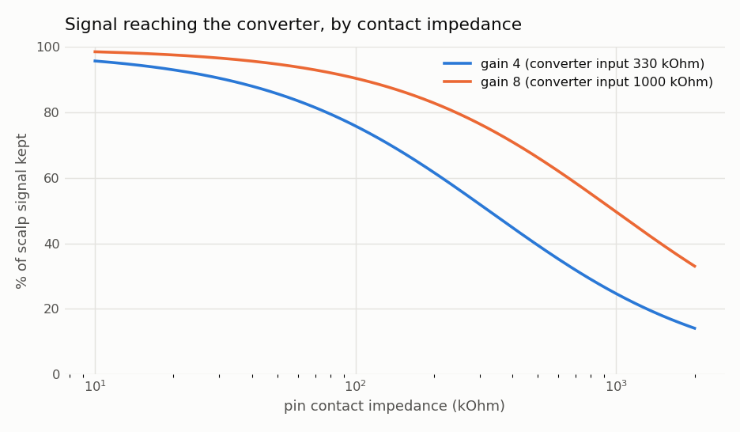
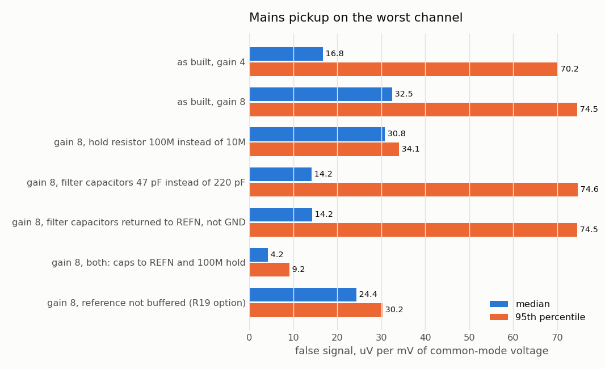
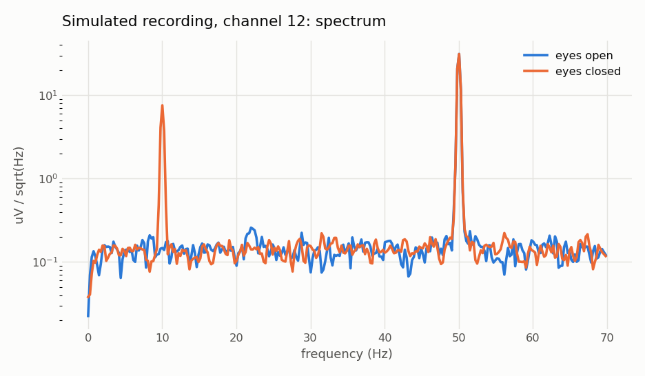

# Limpet-16 rev B: simulation results

Generated by `python3 sim/run_all.py`. Nothing here is a measurement: no board exists yet.
Tags: **[board]** read from the PCB file, **[datasheet]** typical datasheet figures, **[assumed]** a guess that the experiment sweeps or states.

## 1. Wiring and data path [board + real firmware code]

- Module pins the copper connects to the converters match the firmware's pin numbers: **all 9 checks pass**.
- A different test tone on each of the 16 pins, through the firmware driver, packet code and the recorder's decoder: **16 of 16 channels come out where the silkscreen says**, amplitude error 0.003 %, 0 of 2500 packets lost.
- Not covered: `main.cpp` (interrupts, Bluetooth, timing). The simulated converter is my reading of the datasheet.

## 2. Signal that reaches the converter [datasheet input impedance]

| Contact impedance | 10 kOhm | 30 kOhm | 100 kOhm | 300 kOhm | 1000 kOhm |
|---|---|---|---|---|---|
| Gain 4 | 96 % | 90 % | 76 % | 52 % | 25 % |
| Gain 8 | 99 % | 97 % | 90 % | 76 % | 50 % |

## 3. Random contact quality, 200,000 trials [assumed: 20 kOhm - 1 MOhm per pin]

Hum is the false signal on the worst of the 16 channels per millivolt of mains voltage on the body relative to the board. How many millivolts there will be is unknown.

| Case | Signal kept (median) | Weakest / strongest channel | Hum, median | Hum, 95th pct |
|---|---|---|---|---|
| as built, gain 4 | 69 % | 0.30 | 16.8 uV/mV | 70.2 uV/mV |
| as built, gain 8 | 87 % | 0.55 | 32.5 uV/mV | 74.5 uV/mV |
| gain 8, hold resistor 100M instead of 10M | 87 % | 0.55 | 30.8 uV/mV | 34.1 uV/mV |
| gain 8, filter capacitors 47 pF instead of 220 pF | 87 % | 0.55 | 14.2 uV/mV | 74.6 uV/mV |
| gain 8, filter capacitors returned to REFN, not GND | 87 % | 0.55 | 14.2 uV/mV | 74.5 uV/mV |
| gain 8, both: caps to REFN and 100M hold | 87 % | 0.55 | 4.2 uV/mV | 9.2 uV/mV |
| gain 8, reference not buffered (R19 option) | 87 % | 0.55 | 24.4 uV/mV | 30.2 uV/mV |

Ran on: cpu (numpy); no CUDA device visible.

## 4. Noise floor [datasheet; contacts assumed 200 kOhm]

| Gain | Converter | Contacts (thermal) | Buffer | Referred to the scalp, 0-125 Hz | In the 8-12 Hz band |
|---|---|---|---|---|---|
| 1 | 1.90 | 0.93 | 0.15 | 3.44 uV rms | 0.61 uV rms |
| 2 | 1.69 | 0.93 | 0.15 | 3.14 uV rms | 0.56 uV rms |
| 4 | 1.56 | 0.93 | 0.15 | 2.95 uV rms | 0.53 uV rms |
| 8 | 0.95 | 0.93 | 0.15 | 1.61 uV rms | 0.29 uV rms |
| 16 | 0.64 | 0.93 | 0.15 | 1.37 uV rms | 0.25 uV rms |
| 32 | 0.42 | 0.93 | 0.15 | 1.24 uV rms | 0.22 uV rms |
| 64 | 0.42 | 0.93 | 0.15 | 1.24 uV rms | 0.22 uV rms |
| 128 | 0.42 | 0.93 | 0.15 | 1.24 uV rms | 0.22 uV rms |

## 5. Room for electrode DC offsets [datasheet range; offset spread assumed]

| Gain | Largest offset that fits | Chance a channel clips, 25 mV rms spread | 50 mV | 100 mV |
|---|---|---|---|---|
| 1 | 1947 mV | 0 % | 0 % | 0 % |
| 2 | 973 mV | 0 % | 0 % | 0 % |
| 4 | 487 mV | 0 % | 0 % | 0 % |
| 8 | 181 mV | 0 % | 0 % | 69 % |
| 16 | 91 mV | 0 % | 69 % | 100 % |
| 32 | 45 mV | 69 % | 100 % | 100 % |
| 64 | 23 mV | 100 % | 100 % | 100 % |
| 128 | 11 mV | 100 % | 100 % | 100 % |

## 6. A simulated recording, eyes open then closed [source shape assumed]

Alpha source: 20 uV at its peak against a distant reference, a smooth bump 30 mm wide (sigma); mains 1 mV rms on the body; random contacts and offsets. No background brain activity is modelled, so the eyes-open baseline is only electronics noise and these counts are optimistic.

| Scenario | Largest real pin-to-reference difference | Channels showing alpha at 3x baseline | Best closed/open ratio |
|---|---|---|---|
| board 30 mm off the peak, gain 4 | 7.2 uV | 10 of 16 | 14.8 |
| board 30 mm off the peak, gain 8 | 7.2 uV | 15 of 16 | 25.6 |
| board centred on the peak, gain 4 | 1.6 uV | 0 of 16 | 2.1 |

Mains line in that recording: 14-20 uV rms per channel for the assumed 1 mV.

## 7. Bluetooth queue [assumed host behaviour]

Share of packets dropped by the firmware's 64-packet queue:

| Connection interval | 2 packets per event | 4 packets per event | 6 packets per event | 10 packets per event |
|---|---|---|---|---|
| 7.5 ms | 0 % | 0 % | 0 % | 0 % |
| 15 ms | 46 % | 0 % | 0 % | 0 % |
| 30 ms | 73 % | 46 % | 20 % | 0 % |
| 50 ms | 84 % | 68 % | 52 % | 20 % |

## 8. Reference buffer stability [estimate, not SPICE]

Two-pole op-amp model fitted to the datasheet's overshoot curve (output resistance 93 ohm, second pole 9.5 MHz, fit error 1.3 percentage points).

| Case | Phase margin | Step overshoot |
|---|---|---|
| as built (R18 = 100 ohm) | 72 deg | 2 % |
| R18 = 22 ohm | 58 deg | 20 % |
| R18 = 0 (cap straight on the output) | 4 deg | 133 % |

